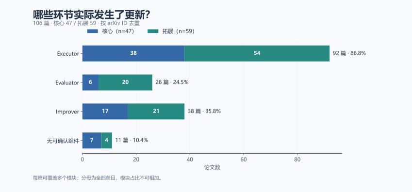
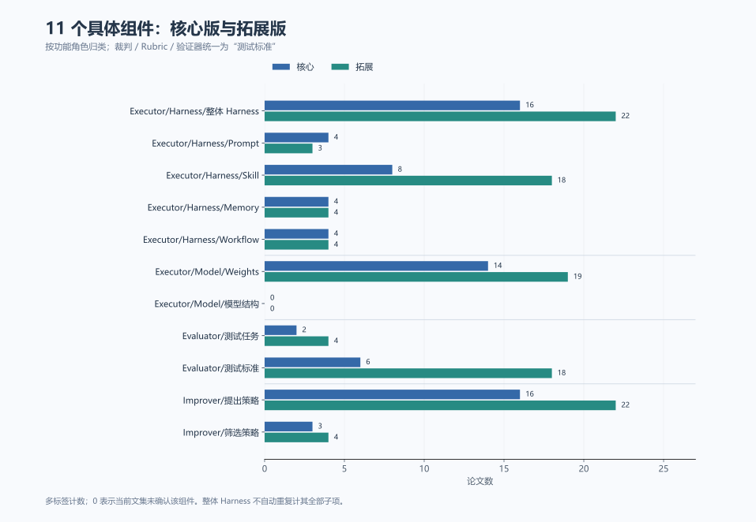
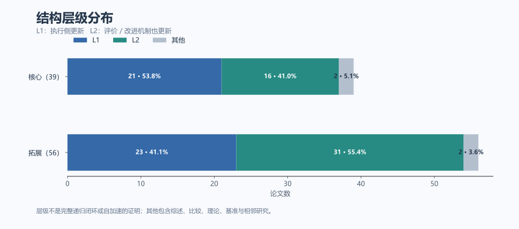
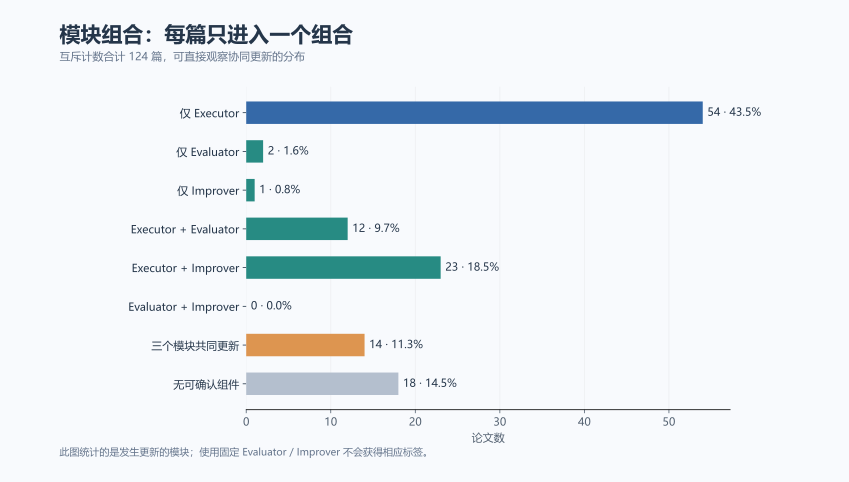

# 2026 RSI 分类复核与统计

更新日期：2026-11-05。本轮按[分类定义](2026RSI_分类定义.md)更新[核心版](2026RSI核心.md)与[拓展版](2026RSI拓展.md)。

共 **124 个条目、124 个不同 arXiv ID**，核心 65 篇、拓展 59 篇；其中 105 篇保留 L1/L2 方法层级，106 篇有可确认组件（含相邻研究的局部更新）。18 篇无可确认组件，仍保留在原文集。

已逐条读取本地摘要与既有分类依据，**27 篇**另核对本对话中的正文相关段落；**23 篇**发生角色归属或层级等实质调整，其余为统一标签层级、名称及依据表述。没有把全部条目说成正文精读。完整旧/新记录见[审计 JSON](rsi_outputs/classification_audit.json)。

**统计口径：** 图表描述这两个已筛选文集，不代表全部 RSI 文献；按 arXiv ID 去重，组件和模块允许多标签。模块内每篇只计一次，分母为全部条目；故模块占比之和可以超过 100%。未归类/不适用仍在分母内。严格 L1/L2 方法子集的统计另列，避免把相邻论文混入方法结论。

## 模块覆盖

| 模块 | 核心 /65 | 拓展 /59 | 合并 | 占全部条目 |
| --- | --- | --- | --- | --- |
| Executor | 49 | 54 | 103 | 83.1% |
| Evaluator | 8 | 20 | 28 | 22.6% |
| Improver | 17 | 21 | 38 | 30.6% |

## 具体组件

| 组件 | 核心 | 拓展 | 合并 | 占全部条目 |
| --- | --- | --- | --- | --- |
| Executor/Harness/整体 Harness | 20 | 20 | 40 | 32.3% |
| Executor/Harness/Prompt | 4 | 3 | 7 | 5.6% |
| Executor/Harness/Skill | 8 | 16 | 24 | 19.4% |
| Executor/Harness/Memory | 4 | 4 | 8 | 6.5% |
| Executor/Harness/Workflow | 7 | 3 | 10 | 8.1% |
| Executor/Model/Weights | 24 | 19 | 43 | 34.7% |
| Executor/Model/模型结构 | 0 | 0 | 0 | 0.0% |
| Evaluator/测试任务 | 2 | 4 | 6 | 4.8% |
| Evaluator/测试标准 | 6 | 18 | 24 | 19.4% |
| Improver/提出策略 | 16 | 21 | 37 | 29.8% |
| Improver/筛选策略 | 3 | 4 | 7 | 5.6% |

## 层级与模块组合

模块组合图将每篇归入一个且仅一个组合，合计等于全部条目。层级图中的“其他”包含未归类、不适用和相邻研究，不等于 L0。

| L1/L2 方法子集模块 | 篇数 | 占方法子集 105 篇 |
| --- | --- | --- |
| Executor | 103 | 98.1% |
| Evaluator | 27 | 25.7% |
| Improver | 38 | 36.2% |

## 关键分类修正

| 论文 / 正文依据 | 修正内容 |
| --- | --- |
| [Evo$^2$: Evolving the Evolver through Weight-Harness Co-Evolution](https://arxiv.org/html/2610.13025#S3) | 移除误标的执行器权重；模型权重的归属先看该模型的角色。 |
| [Recursive Self-Improvement through Multi-Agent Self-Supervision](https://arxiv.org/html/2610.12176#S3) | 同一更新模型明确被复用于三个角色，原 L1 漏掉 Evaluator 与 Improver。 |
| [Skill Self-Play: Pushing the Frontier of LLM Capability with Co-Evolving Skills](https://arxiv.org/html/2607.22529#S3) | 纠正 Skill 的角色归属，同时区分训练题生成与任务质量验证代码。 |
| [WikiSkill: Compiling Agent Experience into Persistent Knowledge for Skill Evolution](https://arxiv.org/html/2608.27454#S3) | Wiki 服务于技能提出者而非主方法的执行器；修正原 Memory 标签并标提出策略。 |
| [ClawLoop: Self-Improving Agents via Harness-Native Training Loop](https://arxiv.org/html/2610.14118#S4) | 同一生成产物按实际训练、诊断、评分用途多标签；不再用任务生成器这一载体统一归 Evaluator。 |
| [SkillMentor: LLM Agent Self-Evolution via Learning Blind-Spot Diagnosis](https://arxiv.org/html/2607.27360#S3) | 这是诊断任务明确进化的补充实例；生成诊断题的模型属于 Evaluator 功能，不计执行器权重。 |
| [Agent-World: Scaling Real-World Environment Synthesis for Evolving General Agent Intelligence](https://arxiv.org/html/2604.18292#S3.SS2) | 明确区分动态诊断题、配套判分代码和后续定向训练题。 |
| [iCoder-27B: Recursive AI-Led Development of Frontier Industrial Coding Model](https://arxiv.org/html/2609.29626#S4) | 按一切表现判断的新口径补充奖励适用/映射机制，避免把原始正确性要求固定等同于整个 Evaluator 固定。 |
| [Dream-RSI: Recursive Self-Improvement through Evolving Worlds](https://arxiv.org/html/2609.14858#S3) | 原笼统的改进策略细分为搜索选择，不把固定最优策略选择门算作进化。 |
| [SkillSmith: Co-Evolving Skills and Tools for Self-Improving Agent Systems](https://arxiv.org/html/2606.01314#S3.SS5) | 筛选规则的有效约束集跨轮学习，区别于仅积累候选成绩。 |

## Evaluator/测试任务名单

以下仅列本轮有证据支持诊断或候选比较用途的动态题集，不把训练出题一并算入。

| 文集/序号 | 论文 | 依据 |
| --- | --- | --- |
| 核心 30 | [DuplexAgent-RSI: Recursive Harness Improvement for Full-Duplex Voice Agent Collaboration](https://arxiv.org/html/2610.11299#S3.SS4) | 协作 Harness 的可编辑流程模块跨轮修订；Exam Planner 根据失败归因与修复档案调整开发测试的采样权重，并加入失败变体，用于测试当前版本和候选版本。固定核心集、保护集、模拟器与评分规则保持不变，因此只增加测试任务标签，不标测试标准或提出策略进化。 |
| 核心 38 | [Mixture of Self-Improving Branches For Agent Harness Optimization](https://arxiv.org/abs/2609.37834) | 各分支迭代 Harness、用于选优的开发任务子集，以及写入 SKILL.md 的提案指导；保留最终分支头的规则固定。 |
| 拓展 5 | [Self-Evolving Coding Agents via Harness-Policy Optimization](https://arxiv.org/abs/2610.22791) | 当前策略继续提出 Harness 改动；难题形成下一轮搜索集，策略权重和 Harness 均更新。 |
| 拓展 8 | [ClawLoop: Self-Improving Agents via Harness-Native Training Loop](https://arxiv.org/html/2610.14118#S4) | 共享策略训练后继续生成下一轮任务与可执行验证器。任务池明确划分训练集与留出诊断集：训练题生成归提出策略，跨轮更新的诊断题集归测试任务，合成的测试判定代码归测试标准；Solver 参数归 Weights。外层准入、拆分与训练算法固定，不据此标筛选策略进化。 |
| 拓展 33 | [SkillMentor: LLM Agent Self-Evolution via Learning Blind-Spot Diagnosis](https://arxiv.org/html/2607.27360#S3) | 受训练的 Mentor 生成用于对照测量冻结执行器与参考模型能力差距的诊断任务，再将暴露的失败转成纠正 Skill。诊断题生成归测试任务，技能编写策略归提出策略，技能库归 Executor/Skill。最大差距选题、候选技能验收和 DELETE 阈值按预设规则执行，不标筛选策略进化。 |
| 拓展 52 | [Agent-World: Scaling Real-World Environment Synthesis for Evolving General Agent Intelligence](https://arxiv.org/html/2604.18292#S3.SS2) | 目标策略经 RL 更新；留出诊断 Arena 每轮生成新题，并为新题合成可执行 Rubric/验证代码，分别归测试任务与测试标准。诊断后扩展的是定向训练数据，不因此自动标提出策略；未发现固定诊断器/合成管线自身被训练或改写的证据。外部最终基准固定。 |

## Improver/筛选策略名单

这里的筛选同时包含数据/持久库的取舍与搜索路径的选择。仅使用固定验收门的论文没有此标签。

| 文集/序号 | 论文 | 为什么规则自身在变化 |
| --- | --- | --- |
| 核心 6 | [ParetoRSI-Gym: Can AI Agents Improve Language Models Across Multiple Domains?](https://arxiv.org/html/2610.34386#S2) | 目标模型经多轮 SFT 更新；正文明确要求按领域反馈改写并跨轮继承书面 principles，用于后续数据搜索、获取和样本取舍，因此同时标提出与筛选策略。SFT 算法和代理/泛化评测协议固定。此处 L2 指程序性指导更新，不表示研究 Agent 权重更新或已证明递归增益。 |
| 核心 23 | [Drafting Agents, Not Just Tokens: Speculative Recursive Self-Improvement for Agentic Systems](https://arxiv.org/html/2610.16491#S3) | 候选执行 Agent/Harness 持续修改；GVO 分别训练起草改动的 Drafter 和选择搜索/验证动作的 Policy，故标提出与筛选策略。Scorer 估计后续搜索收益，属于改进器的搜索价值模型；真实任务评价与最终完整验证验收规则固定。 |
| 核心 51 | [Dream-RSI: Recursive Self-Improvement through Evolving Worlds](https://arxiv.org/html/2609.14858#S3) | 底层发现 Agent 与真实评估器固定；跨轮改写可执行探索策略，决定从哪些父节点继续搜索、开启新分支、并行分配与停止，再直接部署新版策略。其主要更新对象是候选搜索路径/预算的选择规则，因此归筛选策略；历史树回放与最优策略验收规则固定。 |
| 拓展 9 | [Evo$^2$: Evolving the Evolver through Weight-Harness Co-Evolution](https://arxiv.org/html/2610.13025#S3) | 目标任务执行器模型固定，演化对象是其 Harness，以及承担 Proposer/Reflector 的演化器权重。训练后的角色提出编辑，并选择继续修订、跨分支整合或保留候选，故标提出与筛选策略。演化器参数不计入 Executor/Weights；外部任务评测规则固定。 |
| 拓展 40 | [OPD-Evolver: Cultivating Holistic Agent Evolver via On-Policy Distillation](https://arxiv.org/html/2606.17628#S3) | 快速循环更新分层经验与技能；慢循环训练同一策略的执行、经验写入和库维护能力。写入可复用经验归提出策略，学到的 merge/delete 维护决策归筛选策略；不因当前任务的临时记忆检索就单独标改进器。环境反馈及归因公式固定。 |
| 拓展 43 | [SkillSmith: Co-Evolving Skills and Tools for Self-Improving Agent Systems](https://arxiv.org/html/2606.01314#S3.SS5) | 执行技能和工具库更新，工具变化归整体 Harness；版本化 nogood 约束从可重放失败中提炼，作为程序性指导约束后续修复，并否决匹配的重复失败提案，因此同时更新提出与筛选策略。固定的非回归验收公式本身不计进化。 |
| 拓展 49 | [SkillOS: Learning Skill Curation for Self-Evolving Agents](https://arxiv.org/html/2605.06614#S3) | 执行器模型冻结；GRPO 训练策展器对 SkillRepo 作 insert/update/delete。新增和修订技能归提出策略，学到的保留与删除决策归筛选策略；后续相关任务提供长期效用反馈。这里只标技能库和策展器的角色，不把策展器参数计入 Executor/Weights。 |

## 实质变更清单

已合并旧标签的层级命名后再比较，因此下表不把 prompt→Prompt、权重→Weights、Rubric/裁判/验证器合并等纯命名迁移重复算作实质变更。

| 文集/序号 | 论文 | 原层级 → 新层级 | 原组件 | 新组件 | 依据 |
| --- | --- | --- | --- | --- | --- |
| 核心 6 | ParetoRSI-Gym: Can AI Agents Improve Language Models Across Multiple Domains? | L1 → L2 | Executor/Model/权重 | Executor/Model/Weights；Improver/提出策略；Improver/筛选策略 | 原摘要级 L1 漏掉了正文中跨轮改写的书面数据策展原则。 |
| 核心 23 | Drafting Agents, Not Just Tokens: Speculative Recursive Self-Improvement for Agentic Systems | L2 → L2 | Executor/Harness/整体 Harness；Improver/改进策略 | Executor/Harness/整体 Harness；Improver/提出策略；Improver/筛选策略 | 拆出学习到的搜索选择策略；固定最终验收门不计为进化。 |
| 核心 25 | AutoEnvScaling: Automating the Data Flywheel with Terminal Agents | L1 → L2 | Executor/Model/权重 | Executor/Model/Weights；Evaluator/测试标准；Improver/提出策略 | 旧分类遗漏出题器 Harness/权重更新；改进器的载体不误标为执行器 Harness。 |
| 核心 28 | Recursive Self-Improvement through Multi-Agent Self-Supervision | L1 → L2 | Executor/Harness/Workflow；Executor/Model/权重 | Executor/Harness/Workflow；Executor/Model/Weights；Evaluator/测试标准；Improver/提出策略 | 同一更新模型明确被复用于三个角色，原 L1 漏掉 Evaluator 与 Improver。 |
| 核心 30 | DuplexAgent-RSI: Recursive Harness Improvement for Full-Duplex Voice Agent Collaboration | L1 → L2 | Executor/Harness/Workflow | Executor/Harness/Workflow；Evaluator/测试任务 | 动态诊断/候选评测题集确实更新，固定测试生成程序不妨碍题集状态更新。 |
| 核心 51 | Dream-RSI: Recursive Self-Improvement through Evolving Worlds | L2 → L2 | Improver/改进策略 | Improver/筛选策略 | 原笼统的改进策略细分为搜索选择，不把固定最优策略选择门算作进化。 |
| 核心 54 | iCoder-27B: Recursive AI-Led Development of Frontier Industrial Coding Model | L2 → L2 | Executor/Model/权重；Improver/改进策略 | Executor/Model/Weights；Evaluator/测试标准；Improver/提出策略 | 按一切表现判断的新口径补充奖励适用/映射机制，避免把原始正确性要求固定等同于整个 Evaluator 固定。 |
| 核心 60 | Policy-Level Recursive Self-Improvement for Embodied AI with a Criticality World Model | L1 → L2 | Executor/Model/权重 | Executor/Model/Weights；Evaluator/测试标准 | 独立的失败风险预测器区别于普通 RL 只用于优势估计的 value baseline。 |
| 拓展 8 | ClawLoop: Self-Improving Agents via Harness-Native Training Loop | L2 → L2 | Executor/Model/权重；Evaluator/测试任务/任务生成器 | Executor/Model/Weights；Evaluator/测试任务；Evaluator/测试标准；Improver/提出策略 | 同一生成产物按实际训练、诊断、评分用途多标签；不再用任务生成器这一载体统一归 Evaluator。 |
| 拓展 9 | Evo$^2$: Evolving the Evolver through Weight-Harness Co-Evolution | L2 → L2 | Executor/Harness/整体 Harness；Executor/Model/权重；Improver/改进策略 | Executor/Harness/整体 Harness；Improver/提出策略；Improver/筛选策略 | 移除误标的执行器权重；模型权重的归属先看该模型的角色。 |
| 拓展 13 | False Frontiers: Diagnosing and Mitigating Co-Cheating in Self-Evolving Search Agents | L2 → L2 | Executor/Model/权重；Evaluator/测试任务/任务生成器 | Executor/Model/Weights；Improver/提出策略 | 把训练出题器从 Evaluator 移至 Improver。 |
| 拓展 17 | Predict Before You Modify: Learning Improvement Dynamics for Self-Evolving Agents | L2 → L2 | Executor/Harness/整体 Harness；Improver/改进策略 | Executor/Harness/整体 Harness；Evaluator/测试标准；Improver/提出策略 | 真实评估器固定，不排除用于判断候选表现的代理评估器进化。 |
| 拓展 23 | ARISE-RL: Agentic Rubric-Grounded Iterative Self-Evolution with Reinforcement Learning | L2 → L2 | Executor/Model/权重；Evaluator/测试任务/任务生成器；Evaluator/测试标准/Rubric | Executor/Model/Weights；Evaluator/测试标准；Improver/提出策略 | 拆开任务生成与评分准则两个功能。 |
| 拓展 26 | WikiSkill: Compiling Agent Experience into Persistent Knowledge for Skill Evolution | L1 → L2 | Executor/Harness/Skill；Executor/Harness/Memory | Executor/Harness/Skill；Improver/提出策略 | Wiki 服务于技能提出者而非主方法的执行器；修正原 Memory 标签并标提出策略。 |
| 拓展 27 | CAFE: Self-Improving Search Agents Need Co-Evolving Feedback | L1 → L2 | Executor/Model/权重 | Executor/Model/Weights；Evaluator/测试标准 | 原分类以是否负责后代验收排除 Critic，与本轮采用的表现判断口径不一致。 |
| 拓展 28 | SPADE: Self-Play in Adaptive Synthetic Executable Environments | L2 → L2 | Executor/Model/权重；Evaluator/测试任务/任务生成器；Evaluator/测试标准/验证器 | Executor/Model/Weights；Evaluator/测试标准；Improver/提出策略 | 按既有正文核查依据和本地摘要重映射训练环境的角色，本轮未重新读取正文。 |
| 拓展 32 | Self-Play Meets Skill Evolution: Self-Evolving Search Agents that Pose, Solve, and Remember | L2 → L2 | Executor/Harness/Skill；Executor/Harness/Memory；Executor/Model/权重；Evaluator/测试任务/任务生成器 | Executor/Harness/Skill；Executor/Model/Weights；Improver/提出策略 | 训练挑战者改归 Improver，并去掉同一技能库的 Memory 重复标签。 |
| 拓展 33 | SkillMentor: LLM Agent Self-Evolution via Learning Blind-Spot Diagnosis | L2 → L2 | Executor/Harness/Skill；Improver/改进策略 | Executor/Harness/Skill；Evaluator/测试任务；Improver/提出策略 | 这是诊断任务明确进化的补充实例；生成诊断题的模型属于 Evaluator 功能，不计执行器权重。 |
| 拓展 36 | Skill Self-Play: Pushing the Frontier of LLM Capability with Co-Evolving Skills | L2 → L2 | Executor/Harness/Skill；Executor/Model/权重；Evaluator/测试任务/任务生成器 | Executor/Model/Weights；Evaluator/测试标准；Improver/提出策略 | 纠正 Skill 的角色归属，同时区分训练题生成与任务质量验证代码。 |
| 拓展 40 | OPD-Evolver: Cultivating Holistic Agent Evolver via On-Policy Distillation | L2 → L2 | Executor/Harness/Memory；Executor/Harness/Skill；Executor/Model/权重；Improver/改进策略 | Executor/Harness/Skill；Executor/Harness/Memory；Executor/Model/Weights；Improver/提出策略；Improver/筛选策略 | 筛选标签对应被训练的持久库保留/淘汰能力。 |
| 拓展 47 | Learning to Build the Environment: Self-Evolving Reasoning RL via Verifiable Environment Synthesis | L2 → L2 | Executor/Model/权重；Evaluator/测试任务/任务生成器；Evaluator/测试标准/验证器 | Executor/Model/Weights；Evaluator/测试标准；Improver/提出策略 | 生成训练环境不再直接归测试任务；环境内判分代码单独判断。 |
| 拓展 49 | SkillOS: Learning Skill Curation for Self-Evolving Agents | L2 → L2 | Executor/Harness/Skill；Improver/改进策略 | Executor/Harness/Skill；Improver/提出策略；Improver/筛选策略 | 筛选包括学到的持久知识库取舍，不要求另设一个接受/拒绝 Agent。 |
| 拓展 52 | Agent-World: Scaling Real-World Environment Synthesis for Evolving General Agent Intelligence | L2 → L2 | Executor/Model/权重；Evaluator/测试任务/测试任务集 | Executor/Model/Weights；Evaluator/测试任务；Evaluator/测试标准 | 明确区分动态诊断题、配套判分代码和后续定向训练题。 |

## 导出文件

- [在线交互网页](https://lxinchenl.github.io/RSI-papers/)
- [逐篇分类 CSV](rsi_outputs/classification.csv) · [汇总 CSV](rsi_outputs/statistics.csv)
- [分类审计 JSON](rsi_outputs/classification_audit.json) · [统计 JSON](rsi_outputs/summary.json)
- [SVG 图表](rsi_outputs/figures)

网页内嵌全部数据与 SVG 绘图逻辑；论文配图在 Markdown 中引用原始 AlphaXiv 图片地址。
